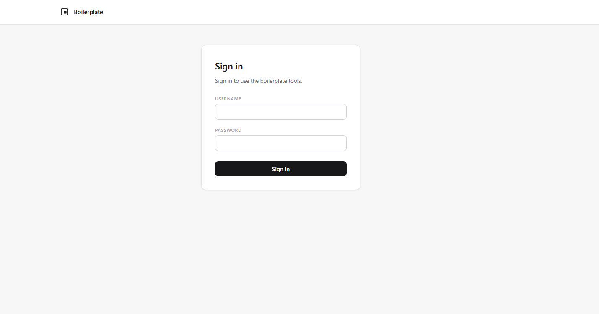
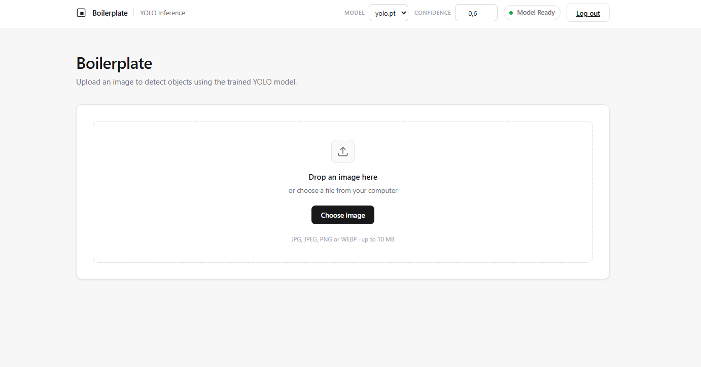
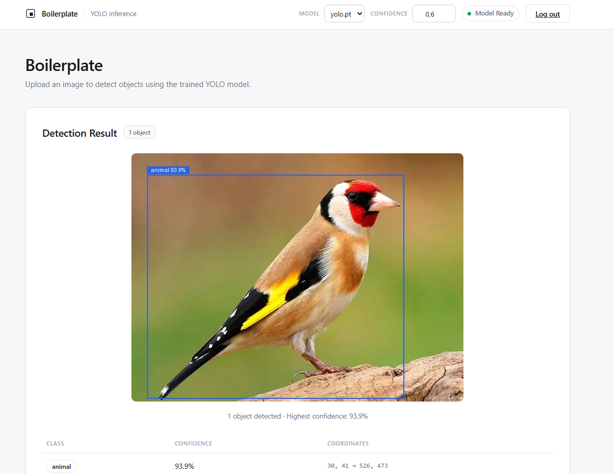

# YOLO Dokploy Boilerplate

A boilerplate for deploying **Ultralytics YOLO detection** models on Dokploy. It includes a Dockerfile and a FastAPI web UI for image uploads, bounding boxes, class labels, and confidence scores. Supply your own compatible `.pt` weights through `MODEL_PATH`.

The repository contains **no model weights or training data**. It supports Ultralytics YOLO **detection** checkpoints. Classification, segmentation, pose, RF-DETR, and arbitrary PyTorch `.pt` files need different inference code.

## What is included

- Web interface with image upload, model selection, annotated result, and detection table.
- Login gate with operator-defined credentials. The `admin/pass` demo account is disabled by default.
- Dockerfile with a CPU PyTorch install and a model readiness health check.
- Optional PostgreSQL request logging, disabled by default.
- Dokploy ZIP build scripts and a detailed [setup guide](USAGE.md).

## Screenshots

**Sign in**



**Image upload**



**Detection result**



## Quick start with Docker

1. Put an Ultralytics YOLO detection weight file, such as `best.pt`, in a local `models/` directory. Set its filename in `MODEL_PATH` below.
2. Build the image from the repository root:

   ```bash
   docker build -t computer-vision-web-deployment .
   ```

3. Start the container with the weights directory mounted:

   ```bash
   docker run --rm -p 8000:8000 \
     -v "$(pwd)/models:/app/models:ro" \
     -e MODEL_PATH=/app/models/best.pt \
     -e MODELS_DIR=/app/models \
     -e AUTH_USER=myuser \
     -e AUTH_PASS=change-this-to-a-strong-password \
     computer-vision-web-deployment
   ```

   On Windows PowerShell, replace `$(pwd)/models` with the absolute host path to the model directory.

4. Open `http://localhost:8000/health`. A loaded model returns HTTP 200 with `model_loaded: true`. Then sign in at `http://localhost:8000/login`.

The model path is always the **path inside the container**. If the file is missing or incompatible, `/health` returns HTTP 503 and the Docker health check marks the container unhealthy.

## Configuration

Use environment variables in Docker or Dokploy. For a local Python run, copy [`.env.example`](.env.example) to `.env` and edit it. Process environment variables take precedence over `.env` values. **Never commit `.env`, credentials, or weight files.**

| Variable | Default | Purpose |
| --- | --- | --- |
| `PORT` | `8000` | Uvicorn listening port. The Dokploy domain container port must match. |
| `MODEL_PATH` | `/app/models/best.pt` in Docker | Exact path to the default Ultralytics YOLO detection `.pt` file. |
| `MODELS_DIR` | `/app/models` in Docker | Directory scanned for additional selectable `.pt` files. |
| `CONFIDENCE` | `0.60` | Default prediction confidence, strictly between 0 and 1. |
| `AUTH_USER`, `AUTH_PASS` | empty | Web login credentials. Configure both for a public deployment. |
| `DEMO_LOGIN_ENABLED` | `false` | Enables the `admin/pass` demo account for local testing only. |
| `LOG_ENABLED` | `false` | Enables optional PostgreSQL request logging. |
| `DATABASE_URL` | empty | PostgreSQL URI, needed only when logging is enabled. |
| `UPLOAD_MAX_MB` | `10` | Maximum uploaded image size. |
| `MAX_IMAGE_PIXELS` | `25000000` | Maximum decoded image area. |

The [example environment file](.env.example) also documents UI text, label aliases, the logging schema, and blocked model names. Model weights are loaded by Ultralytics, so only use checkpoints from a source you trust.

## Deploy on Dokploy

1. Create an **Application** and use the repository as a Git source, or upload a ZIP made with `make_dokploy_zip.ps1 -WithoutModel` using Dokploy's ZIP source.
2. Choose **Dockerfile** as the build type. Set Dockerfile Path to `Dockerfile` and Docker Context Path to `.`.
3. Upload the model to a directory on the host, such as `/home/deploy/cv-models/best.pt`.
4. Add a **Bind Mount** from that host directory to `/app/models` in the container.
5. Set these Dokploy environment variables, using your real model filename and credentials:

   ```ini
   PORT=8000
   MODEL_PATH=/app/models/best.pt
   MODELS_DIR=/app/models
   AUTH_USER=myuser
   AUTH_PASS=replace-with-a-strong-password
   DEMO_LOGIN_ENABLED=false
   LOG_ENABLED=false
   ```

6. In **Domains**, set **Container Port** to `8000`, then deploy. Check the container logs and `/health` before using `/login`.

If the model is included inside a ZIP under `models/`, the bind mount is unnecessary. The ZIP scripts include `.env.example` and exclude `.env`. The ZIP files themselves are generated artifacts and are not tracked in Git. For detailed ZIP and server steps, see [DOKPLOY.md](DOKPLOY.md) and [USAGE.md](USAGE.md).

## Local Python run

Use Python 3.11. Install CPU PyTorch and dependencies as in the [Dockerfile](Dockerfile), copy `.env.example` to `.env`, put a detection model under `models/`, and run:

```bash
uvicorn main:app --host 0.0.0.0 --port 8000
```

The Docker image is the reference installation because it supplies the required system packages. Set `MODEL_PATH` to the local model path in `.env`.

## Endpoints

- `GET /health`: public model readiness; HTTP 200 when the default model is loaded, HTTP 503 otherwise.
- `GET /models`: available server-side weights; requires login.
- `POST /predict`: multipart `image` upload, with optional `model` and `confidence` fields; requires login. Returns detections and a base64 encoded annotated image.
- `GET /login`, `POST /login`, `GET /logout`: browser session flow.

`main:app` is the Docker entry point. `api.server:app` is an optional standalone JSON-only API. It has no login gate and returns box data without an annotated image; secure it separately before exposing it on a network.

## Checks

`python smoke_seams.py` checks the detection adapter and application wiring without weights. `python e2e_real.py --image photo.jpg` runs an end-to-end check with a configured real model. To check the optional Python bundle, run `python make_bundle.py`, `python verify_zip.py`, and `python boot_smoke.py`.

## License

Copyright (C) 2026 Ahmet Harun Ertürk. This project is released under the [GNU Affero General Public License v3.0](LICENSE). The `ultralytics` dependency has its own [AGPL-3.0 and Enterprise licensing terms](https://www.ultralytics.com/license). Model weights and training data are not included and retain their own licenses.
